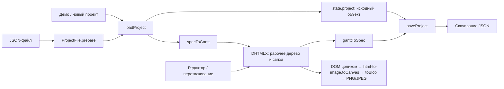

# Архитектура и данные

## Фактическая структура

| Файл | Ответственность |
|---|---|
| `index.html` | Панель управления, диалоги, CDN-подключения и загрузка модулей приложения |
| `app.js` | Одна IIFE: демо, конфигурация Gantt, преобразования данных, редакторы, события, импорт и экспорт |
| `style.css` | Темы, компоненты интерфейса, адаптация стилей DHTMLX, экспорт и приветственный экран |
| `js/project-file.js` | Чистая проверка и нормализация JSON v1, обычный script без зависимостей |
| `tests/` | Node-проверки и дополнительный сценарий Playwright для браузера |
| `AGENTS.md` | Постоянные правила OpenSpec и ponytail |
| `openspec/` | Документация, текущие спецификации и предложения |

В репозитории нет backend, API, сборки, менеджера пакетов или CI. Есть проверки на стандартном Node test/assert и дополнительная браузерная проверка через Playwright. Упоминания React, FHIR и медицинской системы находятся в демонстрационных данных и не являются технологиями самого GanttFlow.

## Зависимости и запуск

- DHTMLX Gantt: JS и CSS одной точной версии `10.0.3` из `https://cdn.jsdelivr.net/npm/dhtmlx-gantt@10.0.3/codebase/`. Обновлять обе ссылки вместе и запускать браузерные проверки; major.minor CDN DHTMLX не фиксирует patch. Интернет по-прежнему необходим.
- html-to-image 1.11.11: UMD-скрипт из unpkg; используется глобальный `htmlToImage`.
- Google Fonts: Inter и JetBrains Mono, с системными резервными шрифтами.
- API браузера: FileReader, Blob, Date, HTMLCanvasElement.toBlob, URL.createObjectURL.

Приложение рассчитано на современный браузер. Матрица совместимости и полностью автономный режим не проверены. Рекомендуемый локальный запуск описан в README; не требуется превращать статический сервер в продуктовый backend.

## Поток данных

`state.project.items/links` не обновляются при каждом редактировании. Рабочий источник задач — DHTMLX, а имя берётся из поля DOM при сохранении. Не следует читать `state.project.items` для актуального плана. Остальное состояние: dirty-флаг, ожидающий импорт/подтверждение, редактируемые и выбранные ID, текущий масштаб. Новая задача временно находится в `newTaskBuffer`. Новый проект сразу dirty; opening/cancel формы не заменяют текущий проект. Изменения имени, сортировки и сворачивания также помечают план изменённым.

`DOMContentLoaded` настраивает Gantt, события, ширины колонок и приветственный экран. DHTMLX отвечает за дерево, строки, полосы, связи и события. Код приложения добавляет формы, пересчёт дат родителей и сериализацию. Два пути импорта имеют общий валидатор, но разные интерфейсы: предварительный просмотр в toolbar и загрузка на стартовом экране. Оба используют readProjectFile → replaceProject → loadProject. При dirty требуется подтверждение. loadProject повторно проверяет файл, сохраняет снимок serialize и откатывает его при исключении; в аварийном случае recoveryProject хранит предыдущий план для кнопки «Сохранить». Устаревшее чтение игнорируется после нового выбора файла/успешной загрузки.

## Файл проекта v1

Формат проверяется ProjectFile.prepare при импорте и перед экспортом. Помимо полей проверяются уникальность ID после нормализации, существование ссылок и отсутствие циклов дерева/зависимостей. Ошибки указывают поле. Отсутствующий links принимается как []; null и другие типы отклоняются.

| Объект | Поля |
|---|---|
| Корень | `schema_version: 1`, `project`, `items[]`, `links[]` |
| `project` | `id`, `name`, `description`, `created_at`, `updated_at` |
| Элемент | `id`, `type`, `parent_id`, `title`, `start_date`, `end_date`, `assignee`, `color`, `emoji`, `progress`, `status`, `sort_order`, `is_expanded`, `notes` |
| Связь | `id`, `source_id`, `target_id`, `type` |

- Тип элемента: `group`, `task`, `milestone`. Подзадача — обычная задача с `parent_id`, отдельного типа нет.
- Корневой `parent_id` равен `null`; в DHTMLX ему соответствует `0`.
- Даты — строки `YYYY-MM-DD`, метаданные создания/обновления — ISO timestamps.
- Прогресс в файле — проценты, в DHTMLX — доля от 0 до 1. Статусы: `planned`, `in_progress`, `done`, `blocked`; статус и прогресс не связаны автоматическим правилом.
- Связи: FS/SS/FF/SF соответствуют 0/1/2/3. Неизвестный тип файла отклоняется валидатором.
- Даты окончания обычных задач в DHTMLX исключительные. Форма, колонка окончания и подсказка вычитают один календарный день из копии даты, форма при сохранении прибавляет день. JSON-экспорт записывает исключительную дату напрямую; импорт передаёт даты без прибавления дня. Например, задача с последним рабочим днём 22 октября сохраняет `end_date: "2026-10-23"`.
- У вехи начало и окончание совпадают; длительность в адаптере равна нулю.
- `sort_order` при импорте определяет порядок корней и детей внутри каждой ветки. Сортировка стабильная: равные значения сохраняют порядок массива, отсутствующее значение считается 0. При сохранении номера вычисляются заново по текущему порядку детей.
- Создаваемые ID — строки с `Date.now()`. Входные ID — непустые строки либо безопасные целые числа; все ID/ссылки нормализуются в строки. Зарезервированные ключи и ID 0 запрещены для элементов. parent_id null/0/"0" означает корень.
- Исходное название сохраняется в raw_title для повторного экспорта; отображаемое название очищается от ведущих эмодзи для совместимости с демо. HTML-подобный текст экранируется при отображении. Произвольные неизвестные поля не сохраняются. `calendar_settings` из исходного плана не поддерживается.

Не менять семантику дат v1 молча: старые ручные файлы и демо могли предполагать включительную дату. Решение о миграции требует примеров реальных файлов; новая семантика должна получать отдельную версию.

## Границы хранения и интеграций

Нет localStorage, IndexedDB, автосохранения или загрузки проекта на сервер приложения. Закрытие страницы теряет данные в памяти. Скачивание файла инициируется браузером; приложение не получает подтверждение записи на диск.

Служебный iframe-скрипт `data-pplx-inline-edit` удалён. Приложение не обрабатывает протокол INLINE_EDIT_* и не отправляет через него снимки страницы или прокрутку родительскому окну. Штатный экспорт использует exportGantt и html-to-image напрямую.

## Правила проверки v1 после исправления импорта

Задача имеет настоящие календарные даты и end_date строго позже start_date; у группы допустимо равенство, у вехи равенство обязательно (отсутствующий end_date вехи нормализуется к start_date). Прогресс — конечное число 0–100; sort_order — неотрицательное конечное число. Цвет — #RRGGBB, is_expanded — boolean. Статус и тип входят в документированные enum. Необязательные текстовые поля при отсутствии получают пустую строку; null вместо строки отклоняется. Временные метки, если присутствуют, должны быть строками, разбираемыми Date.parse.

Файлы с некорректными типами, неизвестными enum или равными датами обычной задачи, которые ранее пропускались, теперь отклоняются. Включительную дату окончания из старого ручного файла не угадываем и автоматически не мигрируем.

## Экспорт изображений

exportGantt временно раскрывает размеры контейнера по всей шкале и видимым строкам, фиксирует ширину таблицы и обнуляет прокрутку. Состояние раскрытия дерева не меняется. htmlToImage.toCanvas захватывает DOM одним изображением, toBlob кодирует PNG/JPEG. finally восстанавливает размеры, настройки ширины таблицы, видимость панелей и прокрутку; внешняя очистка закрывает индикатор, снимает блокировку повторного запуска и освобождает временную ссылку/object URL.

Имя берётся из текущего поля проекта, дата — локальная календарная дата браузера. Export не сохраняет JSON и не сбрасывает dirty. Отдельный image-export.js не вводился: исправление укоротило существующую функцию, новая граница модуля не понадобилась. Ограничение — размер одного canvas и память браузера; проверен план 3128×1332.

Сроки родителей пересчитываются снизу вверх по непосредственным детям с защитой от повторного входа через updateTask. Обновляются даты и duration; при переносе учитываются обе ветки, при удалении — оставшиеся дети. Пустой родитель сохраняет последний диапазон. Импорт не запускает этот проход (applyingProject).

Шкала использует штатный `fit_tasks=true` DHTMLX и подстраивается под новые сроки задач без фиксированных границ. Информационные подсказки не перехватывают события мыши (`pointer-events:none`).

Окна открываются через openModal и закрываются через closeModal. Стек хранит инициаторов и определяет верхнее окно для Tab/Shift+Tab, Escape и focusin; начальный фокус синхронный. Статус «Нет новых изменений» не подтверждает запись файла на диск, а сообщения формы и скачивания разделены.
